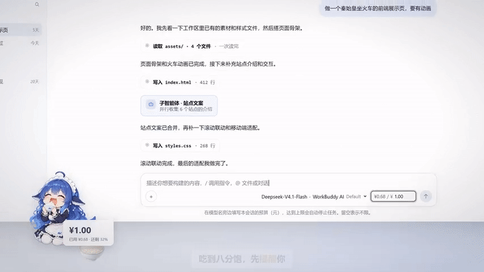
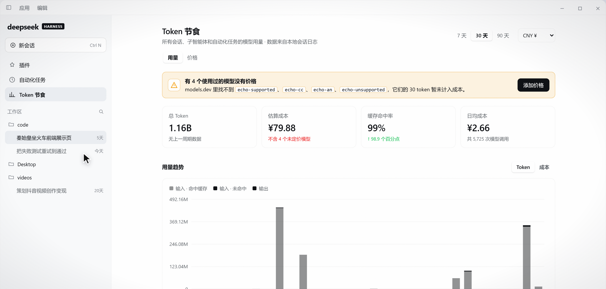

# dsh-token-diet

给 [DeepSeek Harness](https://github.com/deepseek-ai)（dsh）Web GUI 加一双「看账本」和「管饭量」的眼睛：
汇总所有会话、子智能体与自动化任务的 Token 花费，并给每个会话设一条预算红线，吃到就停。

[](https://www.npmjs.com/package/dsh-token-diet)
[](LICENSE)


## 它做什么

- **Token 统计页**：把本机所有会话、子智能体和自动化任务的用量按「日期 × 供应商 × 模型 × 工作区」
  汇总，给出总 Token、估算成本、缓存命中率、日均成本、按天趋势、按模型与按工作区明细。
- **会话预算**：输入框模型名右侧填一个上限（含该会话派出的子智能体），用到 80% 变橙提醒，
  到达 100% 时在下一步模型请求前停下，弹窗可直接「提高预算并继续」。
- **价格与汇率**：价格取自 [models.dev](https://models.dev)，默认人民币展示、可切美元；汇率联网更新，
  支持手动覆盖；查不到价格的模型单独列出，可以自定义价格（含「本地模型按 0 计算」）。
- **模型名映射**：拼写不同但实际是同一个模型的用量会按标准模型计价，界面标注「模型映射」；
  供应商对不上时按模型名模糊匹配，并明确标注这是**不精确的模糊匹配**。

## 演示





演示用的 GIF（800px 宽，镜头 7–8：80% 提醒 → 到达预算停下）与统计页截图都在
[docs/media/](docs/media/)，替换素材时注意体积（GIF ≤ 8 MB）。

## 安装

从 npm 安装：

```bash
dsh plugin add dsh-token-diet
```

安装到桌面端
直接在插件页面，添加插件处输入dsh-token-diet然后安装即可

从仓库目录安装（先在仓库根目录执行）：

```bash
dsh plugin add ./packages/token-diet
```

安装后侧边栏「自动化任务」下方出现「Token 统计」入口，输入框模型名右侧出现预算输入框。
Host 端代码在 dsh 启动时载入，升级或改动 Host 端之后需要**重启 dsh**；客户端刷新页面即可。
更多排查步骤见 [docs/INSTALL.md](docs/INSTALL.md)。

## 使用

**预算框**：在输入框模型名右侧填入本会话上限（默认货币人民币），回车或失焦生效；留空表示不限。
用量到 80% 时输入框变橙，到达 100% 时变红并停止任务——正在输出的回复会正常结束，**下一次模型请求
不再发出**。输入框下方出现红色停止提示，弹窗里填一个更高的上限再点「提高预算并继续」，任务从停下的
那一步继续。预算按根会话计算，它派出的所有子智能体都算进同一条预算；分叉会话会继承预算。
超过预算后再发消息同样不会发出请求，而是再次弹出提示。若一段时间内没有处理弹窗，本次任务按超时结束。

**统计页**：点侧边栏「Token 统计」打开。右上角切换 7 / 30 / 90 天与 CNY / USD；页面分总览、
用量趋势、按模型、按工作区、模型价格几个区段；缺价格的模型会单独列出，可直接补价格或采用建议价。
索引在后台分批扫描历史会话，首次打开可能显示「正在统计历史会话 N/M」。

## 配置

配置写在 profile 的 bundle patch 中本插件行的 `config` 下，全部可选：

```yaml
- id: token-diet
  name: dsh-token-diet
  config:
    displayCurrency: CNY
    rateOverride: 7.2
    modelAliases:
      deepseek-v4.1-flash-sg: deepseek/deepseek-flash
    providerAliases:
      my-relay: deepseek
```

| 键 | 默认值 | 说明 |
| --- | --- | --- |
| `displayCurrency` | `CNY` | 展示货币，仅 `USD` 会切到美元，其余值回退 `CNY` |
| `rateOverride` | 自动 | 固定 USD→CNY 汇率，需为正数；不设则联网更新，之后仍可在价格区手动覆盖 |
| `priceRefreshHours` | `24` | models.dev 价格缓存的小时数，需为正数 |
| `rateRefreshHours` | `12` | 汇率缓存的小时数，需为正数 |
| `budgetHoldSeconds` | `300` | 超预算时挂起当前步、等待「提高预算并继续」的秒数 |
| `scanBatch` | `8` | 历史会话扫描每批处理的会话数 |
| `providerAliases` | 内置表 | 追加「供应商 → models.dev 供应商」映射，内置如 `magpie → deepseek` |
| `modelAliases` | 内置表 | 追加「模型名 → `供应商/模型`」映射，内置 `deepseek-v4.1-flash → deepseek/deepseek-flash` |
| `home` | `$DSH_HOME` 或 `~/.dsh` | dsh 数据目录；一般不需要设置 |

所有数值键都必须为正数，否则回退默认值；完整解析规则见 `packages/token-diet/lib/index.js` 的
`normalizeConfig`。

## 数据与隐私

- **只读** `<DSH_HOME>/sessions/**` 下的会话日志，用来计算用量；不改写、不新增会话事件。
- **只写** `<DSH_HOME>/token-diet/*.json`：`index.v1.json`、`prices.v1.json`、`rate.v1.json`、
  `budgets.v1.json`。它们都是可删除的派生缓存，删掉后会自动重建（预算记录除外）。
- **除价格与汇率外不出网**：仅访问 `models.dev`、`open.er-api.com`、`api.frankfurter.app`，
  传输内容是价格表或汇率，不包含会话内容、提示词或密钥。
- 自定义价格、预算和汇率覆盖都只保存在本机；卸载插件不会自动删除这些文件，可手动清理。

## 文档索引

- [架构与模块契约](docs/ARCHITECTURE.md)：Host/客户端模块边界、RPC 方法表、槽位与预算守卫语义。
- [安装与自检](docs/INSTALL.md)：安装、更新、重启时机与 RPC 自检。
- [开发](docs/DEVELOPMENT.md)：目录结构、构建与测试、配置与硬性约束。
- [贡献指南](CONTRIBUTING.md)：开发环境、提交前检查与改动生效规则。
- [发布流程](RELEASING.md)：版本、打 tag、npm 发布与演示素材上传。

## License

[MIT](LICENSE) © 2026 dsh-token-diet contributors
